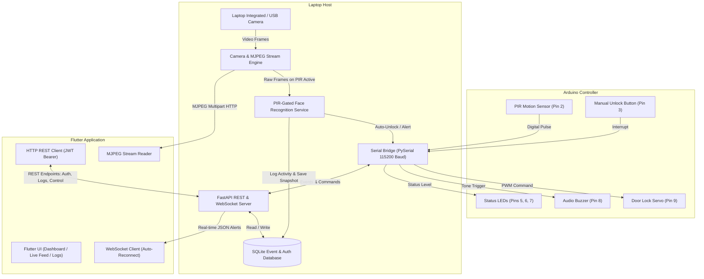
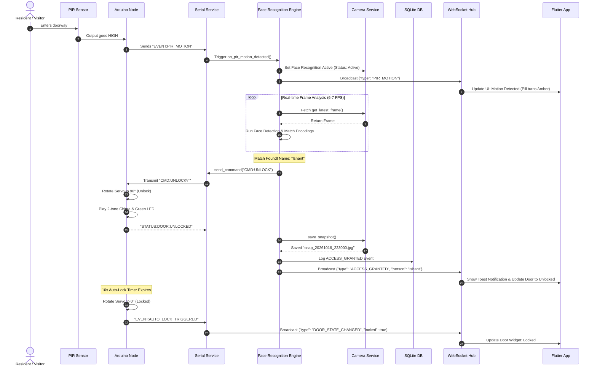
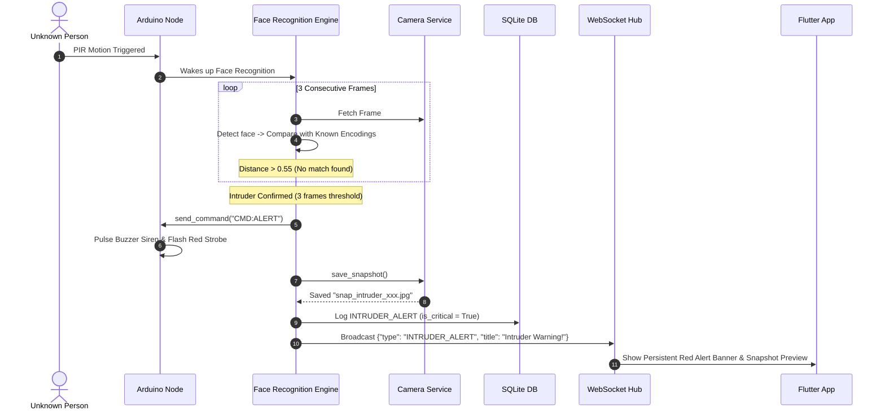
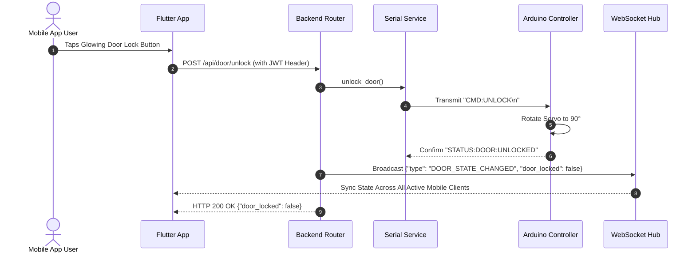
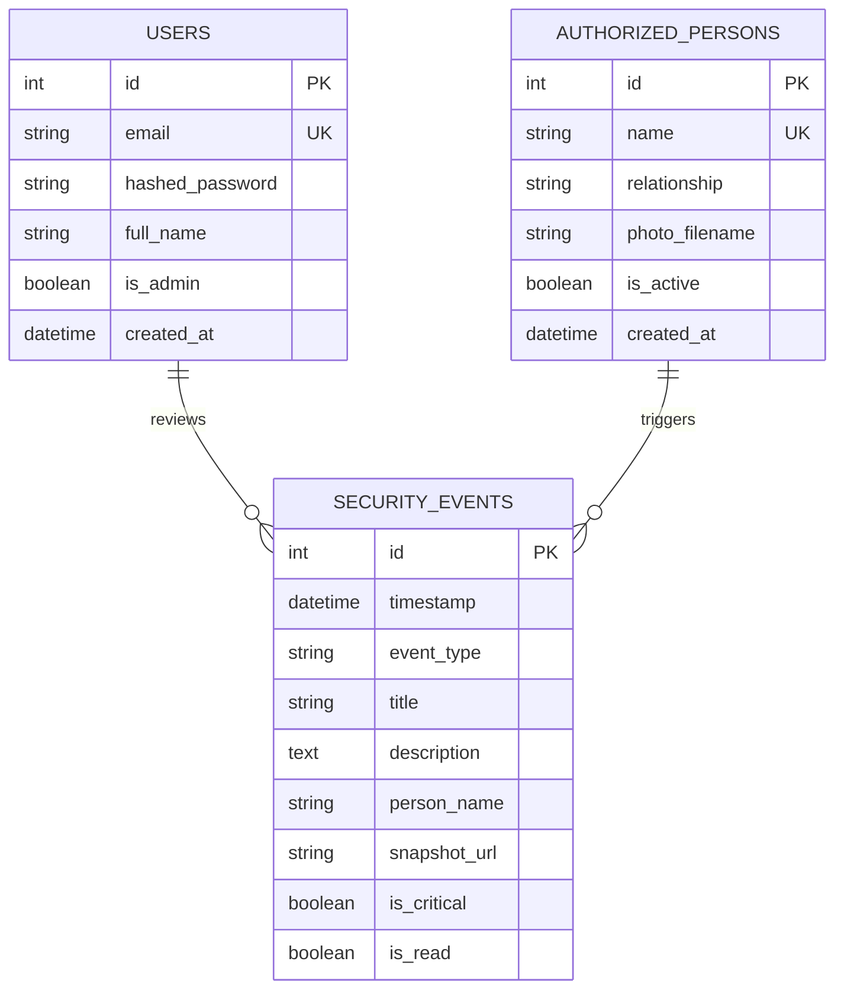

# 🏛️ System Architecture & Data Flow

This document details the architectural design, inter-component communication protocols, sequence diagrams, and database schema for the **Smart Home IoT & Edge AI Security System**.

---

## 1. System Topology Overview

The architecture distributes computing loads between an ultra-low-power micro-controller (Arduino), an Edge AI Server (Laptop), and a Client Controller (Flutter Mobile/Desktop Application).



---

## 2. Event Sequence Workflows

### Sequence 1: PIR-Gated Face Recognition & Authorized Access

When PIR detects motion, Face Recognition wakes up, verifies the face against enrolled embeddings, and opens the door.



---

### Sequence 2: Unrecognized Intruder Alert Pipeline



---

### Sequence 3: Manual Door Control via Mobile App



---

## 3. Database Entity-Relationship Diagram (ERD)

The system utilizes an embedded, zero-configuration SQLite database (`security_hub.db`) managed through SQLAlchemy ORM.



---

## 4. Communication Protocol Specifications

### 4.1. USB Serial UART Protocol
- **Baud Rate**: `115200`
- **Data Bits**: `8`
- **Stop Bits**: `1`
- **Parity**: `None`
- **Line Ending**: `\n` (ASCII)

| Direction | Command / Message | Description |
| :--- | :--- | :--- |
| Arduino ➔ Laptop | `EVENT:PIR_MOTION` | PIR digital output went HIGH (Motion detected) |
| Arduino ➔ Laptop | `EVENT:PIR_IDLE` | PIR output cleared to LOW (Area is clear) |
| Arduino ➔ Laptop | `EVENT:MANUAL_BUTTON_PRESSED` | Physical indoor button toggled |
| Arduino ➔ Laptop | `EVENT:AUTO_LOCK_TRIGGERED` | Hardware auto-lock timer (10s) locked the bolt |
| Arduino ➔ Laptop | `STATUS:DOOR:LOCKED` | Door bolt confirmed in locked position (0°) |
| Arduino ➔ Laptop | `STATUS:DOOR:UNLOCKED` | Door bolt confirmed in unlocked position (90°) |
| Laptop ➔ Arduino | `CMD:UNLOCK` | Move servo to 90°, play chime, enable green LED |
| Laptop ➔ Arduino | `CMD:LOCK` | Move servo to 0°, enable red LED |
| Laptop ➔ Arduino | `CMD:ALERT` | Trigger buzzer siren and strobe red LED |
| Laptop ➔ Arduino | `CMD:STATUS` | Request immediate state report |
| Laptop ➔ Arduino | `CMD:PING` | Connectivity heartbeat (Arduino replies with `PONG`) |

---

### 4.2. Live MJPEG Streaming Protocol
The laptop webcam is served over standard HTTP using the `multipart/x-mixed-replace` MIME type:
- **Endpoint**: `GET /api/video/feed`
- **Content-Type**: `multipart/x-mixed-replace; boundary=frame`
- **Boundary Header**:
  ```http
  --frame
  Content-Type: image/jpeg
  Content-Length: <size>

  <JPEG binary payload>
  ```
- **Frame Rate**: ~25 FPS throttled.
- **Benefits**: Supported natively by web browsers and parsed with zero-latency in Flutter without requiring heavy FFmpeg native libraries or RTSP setup.
