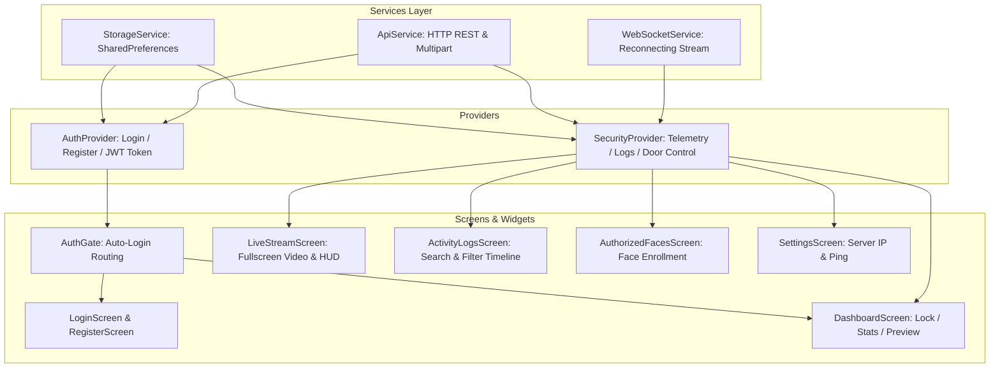

# 📱 Flutter Mobile & Desktop Application Guide

This guide details the cross-platform Flutter application architecture, state management patterns, resilient live stream decoding, and production build instructions.

---

## 1. UI & State Management Architecture

The Flutter application is engineered following the **Provider (ChangeNotifier)** reactive pattern.



---

## 2. Low-Latency MJPEG Stream Engine

Video streaming in mobile IoT apps often struggles with heavyweight RTSP or WebRTC dependencies that fail on Windows or web.

Our application implements a **Pure-Dart Resilient MJPEG Chunk Decoder** ([`lib/widgets/mjpeg_stream_view.dart`](file:///D:/WEB_DEVELOPMENT_@_ISHANT/IOT_project/flutter_app/lib/widgets/mjpeg_stream_view.dart)):
1. Opens an HTTP persistent chunked connection to `/api/video/feed`.
2. Buffers incoming network bytes and scans for JPEG boundary delimiters:
   - `0xFFD8` (JPEG Start of Image - SOI)
   - `0xFFD9` (JPEG End of Image - EOI)
3. Extracts completed frames into `Uint8List` in memory.
4. Renders smoothly using `Image.memory` with `gaplessPlayback: true` for flicker-free 25 FPS video.
5. If the network drops, the widget auto-catches the disconnect and renders a clean **Reconnect** action card.

---

## 3. Real-Time WebSockets Push Subscriptions

The app maintains a persistent background WebSocket to `ws://<server>/ws/events`.
- **Auto-Reconnect**: Automatically attempts reconnection every 4 seconds if the link is severed.
- **Heartbeat**: Emits `"ping"` every 25 seconds to keep firewalls and NAT routers from dropping the connection.
- **Instant Reactive Updates**:
  - `PIR_MOTION` ➔ Sets PIR badge to **ACTIVE**, wakes up Face AI indicator.
  - `PIR_IDLE` ➔ Sets PIR badge to **IDLE**, puts Face AI indicator to sleep.
  - `ACCESS_GRANTED` ➔ Changes door status to unlocked, refreshes activity logs, displays green confirmation banner.
  - `INTRUDER_ALERT` ➔ Displays persistent red warning banner with forensic snapshot thumbnail.

---

## 4. Screen-by-Screen Overview

| Screen | File Location | Key Capabilities |
| :--- | :--- | :--- |
| **Auth Gate** | [`lib/main.dart`](file:///D:/WEB_DEVELOPMENT_@_ISHANT/IOT_project/flutter_app/lib/main.dart) | Checks stored token on launch; routes directly to Dashboard if authenticated |
| **Login / Register** | [`lib/screens/login_screen.dart`](file:///D:/WEB_DEVELOPMENT_@_ISHANT/IOT_project/flutter_app/lib/screens/login_screen.dart) | Clean dark-mode login, credential validation, server host configurator icon |
| **Dashboard** | [`lib/screens/dashboard_screen.dart`](file:///D:/WEB_DEVELOPMENT_@_ISHANT/IOT_project/flutter_app/lib/screens/dashboard_screen.dart) | Interactive 3D glowing DoorLockButton, telemetry chips, hardware test card, live video preview |
| **Live Surveillance** | [`lib/screens/live_stream_screen.dart`](file:///D:/WEB_DEVELOPMENT_@_ISHANT/IOT_project/flutter_app/lib/screens/live_stream_screen.dart) | Fullscreen video stream, HUD bounding boxes, quick unlock toggle, live timestamp |
| **Activity History** | [`lib/screens/activity_logs_screen.dart`](file:///D:/WEB_DEVELOPMENT_@_ISHANT/IOT_project/flutter_app/lib/screens/activity_logs_screen.dart) | Filterable logs (All, Intruders, Face Unlocks, Motion) with snapshot viewer modal |
| **Face Enrollment** | [`lib/screens/authorized_faces_screen.dart`](file:///D:/WEB_DEVELOPMENT_@_ISHANT/IOT_project/flutter_app/lib/screens/authorized_faces_screen.dart) | Add family members via Camera/Gallery, hot-reloads laptop vision model |
| **Settings** | [`lib/screens/settings_screen.dart`](file:///D:/WEB_DEVELOPMENT_@_ISHANT/IOT_project/flutter_app/lib/screens/settings_screen.dart) | Edit backend URL, preset buttons (Localhost, Emulator), real-time ping test |

---

## 5. Building & Deploying the App

### 5.1 Run on Windows Desktop
```bash
cd flutter_app
flutter run -d windows
```

### 5.2 Run on Connected Android Device or Emulator
```bash
cd flutter_app
flutter run -d android
```

### 5.3 Build Standalone Android APK
To install on your personal smartphone:
```bash
cd flutter_app
flutter build apk --release
```
The compiled APK will be generated at:
`flutter_app/build/app/outputs/flutter-apk/app-release.apk`

---

## 6. Networking Configuration for Physical Phones

When testing with a physical smartphone connected to the same home Wi-Fi:
1. Find your laptop's local IP address by running `ipconfig` in PowerShell (e.g., `192.168.1.15`).
2. Ensure Windows Firewall permits incoming connections on port `8000`.
3. In the Flutter app, open **Settings** (or tap the network icon on the Login screen) and set:
   ```
   http://192.168.1.15:8000
   ```
4. Tap **Test Ping** to confirm connectivity!
